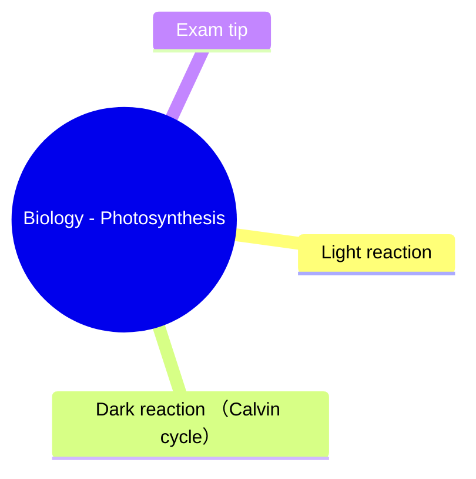
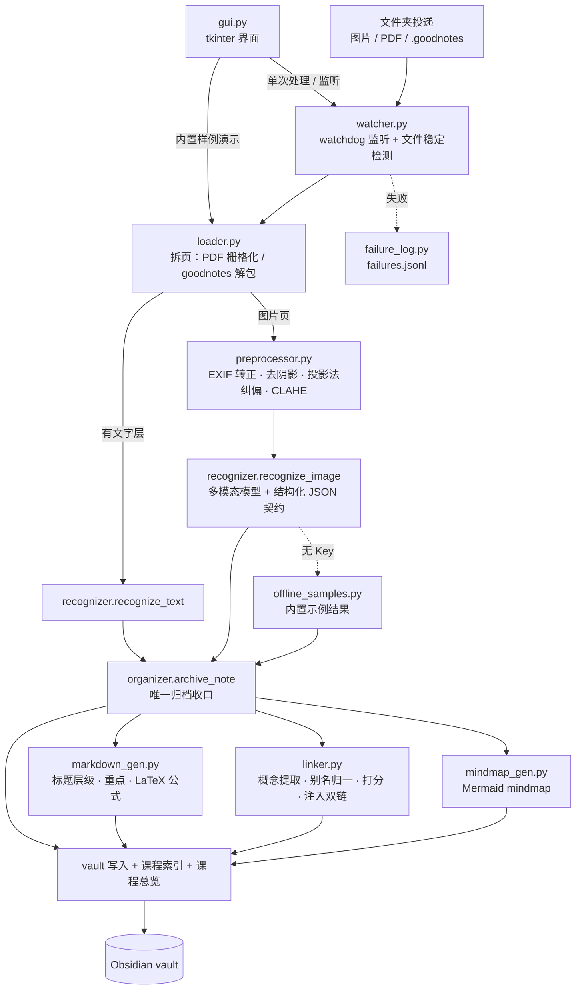

# NoteFlow · 手写笔记智能整理

> 把手写笔记丢进文件夹，它自己变成可检索、可关联、可渲染的电子笔记。

NoteFlow 是一个 Windows 桌面小工具（Python + tkinter 界面，PyInstaller 打包成 exe，
**不需要安装 Python、不需要打开浏览器、不需要登录任何网站**）。它监听你指定的文件夹，
对手写笔记图片 / PDF / GoodNotes 导出文件依次完成
**预处理 → 多模态识别 → 结构化 Markdown → 归档进 Obsidian vault**，
并在归档时自动刷新课程索引、课程总览、Mermaid 思维导图和跨笔记双向链接。

```
手写笔记图片 / 扫描 PDF / GoodNotes 导出
        │
        ▼
   ┌─────────┐   ┌──────────┐   ┌────────────────┐   ┌────────────────┐
   │ 预处理   │ → │ 多模态识别 │ → │ 结构化 Markdown│ → │ Obsidian vault │
   └─────────┘   └──────────┘   └────────────────┘   └────────────────┘
    转正/去阴影      文字+版面结构     标题/重点/公式/箭头     归档/索引/导图/双链
```

---

## 一、它解决什么问题

用 iPad、纸笔或拍照记的笔记，天然有三个硬伤：

1. **只能看，不能搜** —— 手写内容不在任何全文检索里；
2. **不能连** —— 这门课的「导数」和那门课的「微分方程」之间没有链接；
3. **整理成本高** —— 期末回头看，几百页手写笔记要么重抄一遍，要么放弃。

市面上的手写 OCR 大多只给一段「文字墙」，丢了标题层级、重点标记和箭头关系，整理价值有限。
NoteFlow 做的不是「转文字」，而是**转成一份结构完整、能直接放进知识库的笔记**：
识别时同时还原标题层级、荧光笔重点、箭头语义，输出即 Obsidian 可用的 Markdown。

前后效果对比见 [`docs/before-after.html`](docs/before-after.html)（浏览器直接打开，纯静态单文件）。

---

## 二、下载并运行（免安装）

去 **[Releases](../../releases)** 下载 `NoteFlow-<版本>-win64.zip`。

当前最新版本 **v0.1.0**：

| 项 | 值 |
|---|---|
| 附件 | `NoteFlow-v0.1.0-win64.zip` |
| 大小 | 84,806,446 字节（80.9 MiB） |
| SHA-256 | `f6d507cf7cdfe44ca0caa3c814a4d1fb67e9dcfb550d9e20225874ba0ede49f5` |
| 直链 | [NoteFlow-v0.1.0-win64.zip](https://github.com/XueJunHong-X/NoteFlow/releases/download/v0.1.0/NoteFlow-v0.1.0-win64.zip) |

下载后可用 `Get-FileHash .\NoteFlow-v0.1.0-win64.zip -Algorithm SHA256` 核对完整性。

1. 解压 zip，得到一个 `NoteFlow` 文件夹（**不要只拷 exe**，`_internal` 是它的运行库）；
2. 双击 `NoteFlow.exe`；
3. 第一次打开没有 API Key，右上角模式开关显示「**离线示例**」，首屏会提示未配置 Key；
4. 点「**离线演示**」——用随包的 2 张合成样例图跑完整条链路，结束后可在笔记库看到
   Markdown、索引与思维导图（产物写在 `output\sample-demo`，不会混进你的真实笔记）；
5. 处理自己的笔记：把文件/文件夹**直接拖进窗口**即可开始；也可以点「**选择文件**」或
   「**开始处理**」处理收件箱里已有的文件。

> 离线示例不调用任何接口，只是用内置的示例识别结果把链路跑给你看；
> **它不等于真实识别**，横幅与按钮上的文案会一直标明这一点。

### 用真实识别（需要你自己的 API Key）

1. 点右上角「**设置**」，填 API Key（接口地址与模型名已有默认值）；
2. 点「**测试连接**」，看到「连接正常」；
3. 保存后把模式开关拨到「**真实识别**」，再拖入文件或点「开始处理」。

真实识别需要联网，并且会消耗模型额度：**每页一次调用，实测 6–35 秒/页**。
配置只保存在本机 `%APPDATA%\NoteFlow\config.json`，不进仓库、不打进 exe；
界面上 Key 默认打码显示，投屏演示时不会泄露。

> 想用命令行而非桌面界面，也可以把 Key 写进仓库根目录的 `.env`（参考 `.env.example`）。
> 命令行模式读取环境变量 / `.env`，与界面配置互不干扰。

### 界面上的东西

| 区域 | 作用 |
|---|---|
| 拖入区 | 拖文件即开始处理（原文件不复制、不移动）；拖文件夹会把它设为收件箱 |
| 收件箱 / 笔记库 | 当前工作目录，可「更改」；「打开」直接跳过去 |
| 模式开关 | 「真实识别 / 离线示例」一眼可辨，无 Key 时自动回退离线 |
| 开始处理 / 停止处理 | 单次处理收件箱并给出进度；运行中可随时停止，已完成的页保留 |
| 开始监听 / 停止监听 | 常驻监听，往收件箱丢文件即处理 |
| 本次任务 | 进度条、当前文件、已完成页数、失败数与估算消耗 |
| 失败项 | 逐条列出失败文件/页与中文原因，支持「全部重试」 |
| 日志区 | 实时日志，可复制/清空，失败同时写入 `failures.jsonl` |
| 设置 | 收件箱、笔记库、API Key、接口地址、模型名，以及「测试连接」 |

首次启动会自动创建工作目录 `inbox`（收件箱）、`output`（中间产物）与 `vault`（Obsidian 笔记库）；
路径可以在「设置」里改，也可以用环境变量 `NOTEFLOW_WORKSPACE` 指定一个总目录。

### 首次启动与跨机器运行注意事项

- **必须整个文件夹一起拷**，不要单独拷 `NoteFlow.exe`；
- 目标机器需要 64 位 Windows 10 及以上，**不需要装 Python**；
- 首次启动会慢一些（1–3 秒，杀软在扫描新文件），后续正常；
- exe 未做代码签名，Windows SmartScreen 可能提示「未知发布者」，选择「更多信息 → 仍要运行」；
- 极少数机器缺少 VC++ 运行库时会提示缺少 `VCRUNTIME140.dll`，装一次
  [Microsoft Visual C++ 2015-2022 Redistributable (x64)] 即可；
- 真实识别需要能访问模型接口的网络；离线示例完全不需要网络。

---

## 三、从源码运行（开发 / 命令行）

```powershell
# 需要 Python 3.10+（开发环境为 3.12）
python -m venv .venv
.venv\Scripts\Activate.ps1
python -m pip install -r requirements.txt

python gui.py            # 桌面界面（和 exe 完全一样）
python demo.py           # 命令行一键演示：无 Key 自动走离线示例
python main.py --once    # 命令行单次处理
```

### 命令行参数（仍然全部可用）

| 参数 | 作用 |
|---|---|
| `--watch-dir` / `--output-dir` / `--vault-dir` | 覆盖监听目录、输出目录、vault 目录 |
| `--once` | 处理一次后退出，不常驻 |
| `--mock` / `--dry-run` | 离线示例 / 仅拆页与预处理 |
| `--max-pages N` | 每个文档最多处理前 N 页（页数即成本） |
| `--process-existing` | 常驻监听启动时先扫一遍已有文件 |
| `--no-links` / `--refresh-links` | 本次不生成双链 / 按当前 vault 全量重算双链 |
| `--rebuild-vault` / `--rebuild-from` | 用已有 Markdown 重建 vault |
| `--use-onedrive` / `--detect-onedrive` | 写入 OneDrive 同步目录 / 只探测路径 |
| `--log-level` | DEBUG / INFO / WARNING |

exe 也保留了两个命令行入口：

```powershell
NoteFlow.exe --selftest                      # 无界面自检：离线跑完全链路并写报告
NoteFlow.exe --cli --once --mock --watch-dir "D:\我的笔记"
```

`--selftest` 会把结果写到工作区的 `output\selftest\selftest.json`（含页数、耗时、产物路径）。
`--cli` 会沿用桌面版 `config.json` 里的收件箱/输出/笔记库与接口配置，命令行参数优先级更高。

### demo.py 的额外参数

```powershell
python demo.py --mock                            # 强制离线
python demo.py --input 我的笔记\ --out output/x   # 换输入输出
python demo.py --clean                           # 先清空演示输出目录
python demo.py --max-pages 3                     # 每个文档只跑前 3 页（控成本）
```

---

## 四、构建 exe

```powershell
.\build.ps1              # 默认构建（--onedir + --windowed）
.\build.ps1 -SkipInstall # 依赖已装好时跳过 pip
.\build.ps1 -Console     # 临时排查启动问题：构建带控制台的版本
```

构建脚本做了这些事：

- 创建/复用 `.venv`，安装 `requirements.txt` 与 PyInstaller；
- 把 `tests\sample_images\*.png` 复制到一个临时暂存目录后打包 ——
  **只收合成样例图，`tests\sample_images\real\`（个人真实笔记）绝不进安装包**；
- 补齐运行时才 import 的隐藏依赖：`cv2`、`numpy`、`PIL.Image`、`fitz`/`pymupdf`、
  `watchdog.observers.winapi`、`requests` 以及 `src.*` 各模块；
- 打包后裁掉运行时用不到的体积：OpenCV 的视频编解码库、PyMuPDF 的版面/表格 ONNX 模型。

### 体积预期

| 构成 | 约 |
|---|---|
| OpenCV（静态图处理核心） | 110 MB |
| PyMuPDF（PDF 渲染） | 45 MB（裁掉 ONNX 后） |
| numpy + OpenBLAS | 40 MB |
| Tk / Python 运行时 / 其余依赖 | 其余 |
| **实测整目录** | **约 200 MB** |

体积大是「把图像、PDF、GUI 运行时全塞进一个目录」的必然代价；压缩包约 90–110 MB。

---

## 五、支持的输入与真实限制

| 输入 | 处理方式 | 实际表现 |
|---|---|---|
| 图片（png/jpg/jpeg/bmp/webp） | 预处理后整页视觉识别 | 主力场景，中文连笔、数学符号、公式还原到符号级 |
| PDF | 按页栅格化；**有文字层且不是整页图**时优先抽文字，只整理版面 | 印刷体几乎全对；扫描件走视觉识别 |
| `.goodnotes` | 解压 zip 容器，取内嵌位图（课件截图/翻拍照） | **只能读到内嵌图片，读不到矢量笔迹** |

关于 `.goodnotes`，需要明确说明：

- GoodNotes 的笔迹是矢量对象（`notes/*.pb`），不是位图。NoteFlow 目前**没有渲染矢量笔迹**，
  所以它识别的是这个笔记本里插入的课件截图、拍下来的讲义，**不是你自己手写的那部分**；
- 如果一个 `.goodnotes` 里只有笔迹、没有任何位图，程序会明确报错并留痕，不会静默产出空笔记；
- **推荐做法**：在 GoodNotes 里 `分享 → 导出 PDF`，再把 PDF 丢进监听目录。这样手写笔迹会被栅格化，
  识别效果与拍照笔记一致。

其它已知限制：

- `.goodnotes` 的页序是「提取顺序」，不等于 GoodNotes 里的真实页码（frontmatter 中已用 `page_note` 标注）；
- 同尺寸的内嵌图变体未做去重，可能多出一页；
- 跨笔记双链只认字面（「高阶导数」不会自动连到「常用函数的 n 阶导数公式」），靠别名表补充；
- 版面语义仍是模型判断：极少数「解 / 例 / 注」类续写句可能被误判为标题（已做降级兜底），
  装饰性箭头可能被误读成概念关系（已做端点过滤）；
- **桌面版不是「完全离线可用」**：界面是离线的，但真实识别必须联网调用模型；
  没有网络/没有 Key 时只能用离线示例看链路。

---

## 六、输出结构

归档目录按**课程名**分组（学科只作为标签，不参与目录）：

```
<output>/
├── vault/                     ← Obsidian vault，直接用它打开
│   ├── 课程总览.md             ← 顶层索引，自动维护
│   ├── 高等数学/
│   │   ├── 高等数学 索引.md
│   │   └── 常用函数的n阶导数公式.md
│   └── 未分类/                 ← 推不出课程时的兜底，不影响落盘
├── notes/                     ← 渲染后的 Markdown 原始产物
├── preprocessed/              ← 预处理后的图片（排查质量问题用）
├── pages/                     ← PDF / .goodnotes 拆页中间图
└── failures.jsonl             ← 失败留痕：一行一条 JSON
```

单篇笔记的样子：

````markdown
---
title: "Biology - Photosynthesis"
subject: "未分类"
course: "未分类"
source: "sample_note_01.png"
source_type: "image"
created: 2026-01-01T09:00:00
tags: ["Biology", "Photosynthesis"]
---

# Light reaction
Happens in the thylakoid membrane
**Produces ATP and NADPH**        ← 荧光笔/框选重点自动加粗

## 关联概念
- [[#Light reaction]] → Dark reaction (Calvin cycle)（推导）

## 思维导图

````

---

## 七、架构



模块职责：

| 模块 | 职责 |
|---|---|
| `gui.py` | tkinter 桌面界面、线程与日志桥接、演示/单次/监听入口 |
| `demo.py` / `main.py` | 命令行演示入口 / 正式入口（监听、单次、重建、刷新双链） |
| `src/appconfig.py` | 桌面配置读写（`%APPDATA%\NoteFlow\config.json`） |
| `src/watcher.py` | 监听目录、文件稳定检测、去重 |
| `src/loader.py` | 图片 / PDF / `.goodnotes` 统一拆成「页」 |
| `src/preprocessor.py` | EXIF 转正、背景除法去阴影、投影法倾斜矫正、CLAHE |
| `src/recognizer.py` | 多模态调用、JSON 提取与容错、结构规整、兜底 |
| `src/offline_samples.py` | 离线示例识别结果（只给合成样例用） |
| `src/markdown_gen.py` | 结构 → Markdown（标题层级、重点、公式、关联概念） |
| `src/mindmap_gen.py` | 标题层级 → Mermaid mindmap，三种写入模式 |
| `src/linker.py` | 跨笔记双链：概念提取、归一、别名、打分、正文注入 |
| `src/organizer.py` | 归档收口、课程推断、索引与总览维护、vault 重建 |
| `src/failure_log.py` | 统一失败留痕 |

关键设计：**识别层不知道 vault 里有什么，渲染层不知道别的笔记**。所有「跨笔记」的事
都收口在 `organizer.archive_note`，所以界面、命令行、离线重建三条入口自动共享同一套逻辑。

---

## 八、环境变量与配置

桌面版的配置优先级：**界面保存的 config.json > 环境变量 / `.env` > 内置默认值**。
命令行模式则完全沿用环境变量（兼容原有用法）。

| 变量 | 默认值 | 说明 |
|---|---|---|
| `NOTEFLOW_API_KEY` | 空 | 多模态模型密钥；为空时只能 `--mock` / `--dry-run` |
| `NOTEFLOW_API_BASE` | 阿里云百炼 compatible-mode | OpenAI 兼容接口地址 |
| `NOTEFLOW_MODEL` | `qwen-vl-max` | 模型名；需支持图片输入的多模态模型 |
| `NOTEFLOW_WATCH_DIR` | `./inbox` | 监听目录（桌面版改用界面里的设置） |
| `NOTEFLOW_OUTPUT_DIR` | `./output` | 输出目录 |
| `NOTEFLOW_TIMEOUT` | `60` | 单次请求超时（秒） |
| `NOTEFLOW_MAX_RETRIES` | `2` | 限流 / 5xx 重试次数（指数退避） |
| `NOTEFLOW_CONCURRENCY` | `2` | 识别并发数（1/2/4），限流时自动降级 |
| `NOTEFLOW_MAX_IMAGE_SIDE` | `1800` | 送模型前图片最长边 |
| `NOTEFLOW_JPEG_QUALITY` | `90` | 预处理输出的 JPEG 质量 |
| `NOTEFLOW_LOG_LEVEL` | `INFO` | 日志级别 |
| `NOTEFLOW_VAULT_DIR` | `<output>/vault` | vault 根目录（可指向已有 vault） |
| `NOTEFLOW_VAULT_LAYOUT` | `{course}` | 目录模板，支持 `{course}` `{subject}` `{document}` |
| `NOTEFLOW_VAULT_ONEDRIVE` | `off` | 设为 `on` 自动探测 OneDrive 并写入 `<OneDrive>/NoteFlow` |
| `NOTEFLOW_MINDMAP_MODE` | `inline` | `inline` 写进笔记 / `file` 独立文件 / `off` 关闭 |
| `NOTEFLOW_MOC` | `on` | 是否生成课程索引与课程总览 |
| `NOTEFLOW_PDF_TEXT_MIN_CHARS` | `40` | 文字层达到多少字才算「可读文本页」 |
| `NOTEFLOW_PDF_IMAGE_COVERAGE` | `0.2` | 页面图片覆盖率超过该值仍走视觉识别 |
| `NOTEFLOW_LINKS` | `on` | 是否启用跨笔记双链 |
| `NOTEFLOW_LINK_MIN_SCORE` | `3` | 链接最低权重，越高越保守 |
| `NOTEFLOW_LINK_MAX_PER_NOTE` | `4` | 单篇最多注入几条链接 |
| `NOTEFLOW_LINK_MIN_NOTES` | `3` | vault 少于该篇数不做跨笔记链接（冷启动保护） |

课程 → 学科的映射表在 [config.py](config.py) 的 `DEFAULT_SUBJECT_KEYWORDS`，
概念别名表在 `DEFAULT_CONCEPT_ALIASES`，都可以直接改。

桌面版配置文件（`%APPDATA%\NoteFlow\config.json`，**不要提交、不会打包**）：

```json
{
  "watch_dir": "...\\inbox",
  "output_dir": "...\\output",
  "vault_dir": "...\\vault",
  "api_base": "https://dashscope.aliyuncs.com/compatible-mode/v1",
  "model": "qwen3-vl-plus",
  "api_key": "（这里只存在本机）",
  "offline_mode": false
}
```

---

## 九、稳定性与成本

- **单点失败不中断**：单页识别失败、索引刷新失败、导图生成失败都只告警 + 写 `failures.jsonl`，
  后续文件继续处理；笔记落盘永远不会因为索引/导图失败而被阻塞。
- **JSON 契约 + 兜底**：识别要求严格 JSON；解析失败先自动追加一次纠错请求，
  仍失败则退化成「原文 + 待校对」，保证流水线不空转。
- **双链「有目标才成链」**：链接目标必须是 vault 里真实存在的笔记，找不到就保持纯文本，
  因此不会产生悬空链接；同时有三道闸（笔记总数阈值、权重阈值、单篇上限）防噪音。
- **成本可控**：PDF 按页计费，`--max-pages` 可截断；`--rebuild-vault`、`--refresh-links`、
  双链计算、索引与导图全部是**本地计算，0 次模型调用**；`--dry-run` 只跑预处理。

---

## 十、目录结构

```
.
├── gui.py                   # 薄入口：图形界面 / --selftest / --cli
├── demo.py                  # 命令行一键演示
├── main.py                  # 命令行正式入口：监听 / 单次 / 重建 / 刷新双链
├── build.ps1                # 一键打包（onedir + windowed）
├── config.py                # 配置、课程-学科映射、别名与停用词
├── requirements.txt
├── docs/                    # 项目说明与前后对比页
│   ├── before-after.html
│   └── 项目说明.md
├── src/
│   ├── appconfig.py         # 桌面配置（%APPDATA%\NoteFlow\config.json）
│   ├── controller.py        # 任务编排：线程、事件、失败收集、测试连接
│   ├── resources.py         # 开发态 / 打包态资源路径
│   ├── ui/                  # 界面层：只做展示与事件，不碰流水线
│   │   ├── theme.py         # 色板、字体、DPI 缩放、ttk 主题
│   │   ├── widgets.py       # 圆角卡片、按钮、拖入区、进度条、日志、失败项
│   │   ├── settings_dialog.py  # 设置弹窗（含测试连接）
│   │   └── app.py           # 主窗口布局与交互
│   ├── watcher.py           # 文件夹监听
│   ├── loader.py            # 图片 / PDF / .goodnotes 拆页
│   ├── preprocessor.py      # 去阴影、纠偏、增强
│   ├── recognizer.py        # 多模态识别 + 结构规整
│   ├── offline_samples.py   # 离线示例识别结果
│   ├── markdown_gen.py      # Markdown 渲染
│   ├── mindmap_gen.py       # Mermaid 思维导图
│   ├── linker.py            # 跨笔记双链
│   ├── organizer.py         # 归档、索引、总览、重建
│   ├── failure_log.py       # 失败留痕
│   └── onedrive.py          # OneDrive 目录探测与可写校验
└── tests/sample_images/     # 合成样例图（会打进 exe）
```

---

## 十一、素材与隐私

- 对外材料只使用 `tests/sample_images/` 下的**合成样例图**，它们也是 exe 里唯一的示例素材；
- `tests/sample_images/real/`（个人真实笔记）不进提交物、不进安装包（构建脚本只拷贝 `*.png`）；
- `.env`、`config.json`、`%APPDATA%\NoteFlow\config.json` 都不进仓库；
- 代码、文档、打包产物中不出现任何密钥；界面里 Key 默认打码。

### 数据流向（一眼看懂）

- **本机做的**：拆页、去阴影/纠偏、按课程归档、生成 Markdown / 索引 / 思维导图、写失败记录 `output\failures.jsonl`；
- **会上传的**：只在「真实识别模式」下，把**当前页的图片**（或 PDF 该页的文字）发送到**你自己配置的**云端多模态模型接口；
- **不会上传的**：API Key 以外的其他笔记、目录结构、使用记录；密钥只用于请求头鉴权；
- **落在哪**：笔记写到你在界面里选的 vault 目录，预处理图在 `output\preprocessed`、拆页图在 `output\pages`；
- **密钥存哪**：只存 `%APPDATA%\NoteFlow\config.json`（或环境变量 / `.env`），不进仓库、不打进 exe；
- **离线示例模式**：全程本机，不发起任何网络请求。

---

## 十二、许可证

本项目采用 [MIT License](LICENSE) 开源。

Copyright (c) 2026 XueJunHong

你可以自由使用、修改、分发本项目的代码，包括商业用途，只需保留原始版权声明与许可声明。本软件按「现状」提供，不附带任何明示或暗示的担保。
